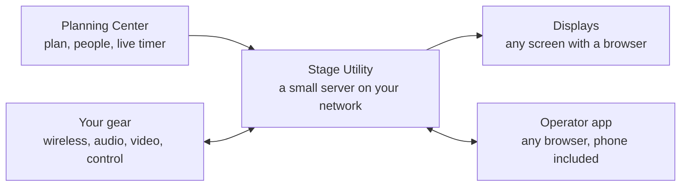
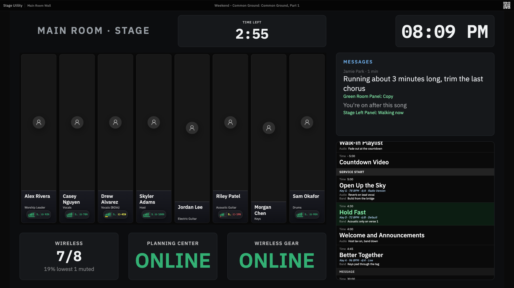

# Stage Utility

Monitors around a stage, showing your production team what they need during a
service — who is on which mic, what slide is up, how loud it is, how far behind
the plan you are.

It reads your service plan from **Planning Center** and pulls live data from the
gear you already run: wireless receivers, ProPresenter, OBS, SPL meters, people
counters, cameras. A small Node server on your own network drives the screens,
the operator app and a phone remote from one port.

---

## Contents

**In this file** — [How it works](#how-it-works) · [What it does](#what-it-does) ·
[Install it](#install-it) · [What it connects to](#what-it-connects-to) ·
[Branches and releases](#branches-and-releases)

**Documentation**

| | |
|---|---|
| [Install, deploy and configure](docs/ops/install-and-config.md) | putting it on a machine, running it in development |
| [Integrations](docs/integrations/README.md) | every device and service it talks to |
| [The operator app](docs/features/operator-app.md) | Home, the sidebar and consoles — where an operator works |
| [Data model](docs/reference/data-model.md) | Views, Outputs and Slots — the nouns |
| [Layout editor](docs/reference/layout-editor.md) | placing objects, other window shapes, motion |
| [Widget reference](docs/reference/widgets.md) | every widget, what it shows and where the data comes from |
| [Display URLs](docs/display-urls.md) | addressing screens |
| [Kiosk devices](docs/kiosk-devices.md) | the agent a screen runs, claiming it, and the Mac output helper (SDI out) |
| [The context bar](docs/features/context-bar.md) | the live strip above every operator page |
| [Stage messages](docs/features/stage-messages.md) | groups of screens, and messages sent to them |
| [Slots](docs/slots.md) | matching people and devices to positions |
| [Video feeds](docs/integrations/video-feeds.md) | cameras and program video on screens, through the built-in relay |
| [Companion and Home Assistant](docs/integrations/companion.md) | stream-deck control, commands called by name, home automation |
| [Moving a view](docs/moving-a-view.md) | taking one layout to another install |
| [Attendance and service history](docs/features/attendance-and-history.md) | what a service records, and reading it back |
| [ServiceCue and Baptisms](docs/features/servicecue-and-baptisms.md) | two operator surfaces on the plan |
| [ServiceCue on the web](docs/ops/servicecue-on-the-web.md) | a public address for ServiceCue on a free Cloudflare Worker, with no login |
| [Patch sheet](docs/patch-sheet/README.md) | the stage patch sheet |
| [Automation](docs/automation.md) | rules that fire on live events |
| [Data archive](docs/data-archive.md) | raw sample retention, export and import |
| [Reliability and data](docs/ops/reliability.md) | behaviour under load, where your data lives |
| [Network traffic](docs/ops/network-traffic.md) | what it puts on your LAN |
| [Homebrew](docs/ops/homebrew.md) | running it as a login agent on a Mac or Linux workstation |
| [Updates and logs](docs/ops/updates-and-logs.md) | the in-app updater, and the log page |
| [Releases and distribution](docs/ops/distribution.md) | how versions are cut, and how a server gets one |
| [API reference](docs/reference/api.md) | the HTTP surface |
| [ServiceCue publishing protocol](docs/reference/servicecue-publishing.md) | what a server sends to the public ServiceCue Worker, and what it answers |
| [Code scanning](docs/reference/code-scanning.md) | how credentialed requests and cached downloads are kept to their own origin |
| [Contributing](docs/contributing.md) | commit convention, branching, releases |
| [Project structure](docs/contributing-appendix.md) | orientation in the codebase |
| [App shell redesign](docs/design/app-shell-redesign.md) | why the operator shell, consoles and in-place editing are shaped the way they are |

---

## How it works

Each screen is a **display** — a browser at its own URL, typically a Pi or a
smart TV. A display shows a **view**: the content you built, which can be a mic
slot grid, a tech dashboard, a stage/confidence screen, full-screen captions, or
a layout you design yourself by dragging clocks, timers, slide text and mic grids
onto a canvas.


Views and displays are separate on purpose. Build a view once and point as many
screens at it as you like; change the view and every screen follows. A
phone-friendly remote runs on the same network, so someone on the floor can
reassign a mic or switch plans without going back to the booth.



The server holds the connections to your gear, resolves the current plan into
slots, and pushes changes to every screen over one event stream. Planning Center
is the one required connection outside your network. A few optional integrations
call out too (SenSource Vea, SafeSpace, ESPN scores, YouTube, Resi), and the
updater reads GitHub. Video is relayed on your LAN by the server's own relay,
never by a cloud service.

**Does it fit your setup?** You need Planning Center Services, a machine to run it
on (a Pi is enough), and screens that can open a URL. Everything else is optional
— the app works with whatever subset of gear you have, and each integration is
enabled independently.

## What it does

| | |
|---|---|
| **Operator app** | One address for everything an operator does: Home (a grid of live tiles), Screens, ServiceCue, Patch, Automation, Plan, History, Baptisms, Messages, Integrations, Branding and Advanced. A live service strip sits above every page, and it works on a phone. [The operator app](docs/features/operator-app.md), [The context bar](docs/features/context-bar.md) |
| **Screens** | A card for every physical screen with a live preview, the view it shows, and its own settings. A machine heard on the network that is not set up yet appears in a banner at the top of Screens, ready to claim. [Operator app](docs/features/operator-app.md#screens), [Kiosk devices](docs/kiosk-devices.md) |
| **Views and layouts** | Mic slot grids, a tech dashboard, a stage screen, captions, a ServiceCue rundown, an SPL rundown, a Planning Center calendar, or a custom layout you draw on a canvas from the widget registry. A view marked as a console is a live control surface rather than a read-only wall. [Data model](docs/reference/data-model.md), [Layout editor](docs/reference/layout-editor.md), [Widgets](docs/reference/widgets.md) |
| **Mic slots** | Positions and people from the plan matched to channels, with RF and battery beside the name. A default board per service type, and an override for one plan. [Slots](docs/slots.md), [Wireless](docs/integrations/wireless.md) |
| **Stage messages** | Short messages from the booth to groups of screens, or to everyone, with an optional alert that holds the screen and one-press replies from a console. [Stage messages](docs/features/stage-messages.md) |
| **Mac output helper** | A menu bar app that turns a Mac's displays and the ports of a Blackmagic DeckLink or UltraStudio card into screens, so a view can go out over SDI. [Kiosk devices](docs/kiosk-devices.md#mac-output-helper) |
| **Video feeds** | Cameras and program video on screens and on Home, Pulled and pushed sources go through a built-in relay (MediaMTX) and play over WebRTC, or HLS where a screen needs it; embedded and external sources play without it. [Video feeds](docs/integrations/video-feeds.md) |
| **ServiceCue and Baptisms** | The plan as a rundown with the note columns each department needs and a live countdown, and a timer for testimonies and baptisms. [ServiceCue and Baptisms](docs/features/servicecue-and-baptisms.md) |
| **History and trends** | Every service is recorded: attendance, sound levels and item timing, with trends across weeks, a calendar, dated milestones and a spreadsheet export. The raw samples can be exported and imported. [History](docs/features/attendance-and-history.md), [Data archive](docs/data-archive.md) |
| **Patch sheet** | A weekly stage patch with variants, read by volunteers at `/patch` and exported as CSV or Excel. [Patch sheet](docs/patch-sheet/README.md) |
| **Automation** | Rules of the form "when something happens in Stage, do something to a device", and commands that Companion, Home Assistant or a console button call by name. Simulate mode is on by default. [Automation](docs/automation.md) |
| **Companion and Home Assistant** | A Bitfocus Companion module drives and reads Stage; commands reach Home Assistant, and through it Apple Home, as switches that report what the gear is doing. [Companion](docs/integrations/companion.md) |
| **Running it** | Install with one line, update from inside the app, take config snapshots and automatic backups, and read the server's log at `/log`. [Install and config](docs/ops/install-and-config.md), [Updates and logs](docs/ops/updates-and-logs.md) |



## Install it

Two supported ways in — pick whichever suits the machine.

**Linux and macOS**

```bash
curl -fsSL https://raw.githubusercontent.com/Cornerstone-Production/Stage-Utility/main/install.sh | sudo bash
```

**Windows** — in an Administrator PowerShell:

```powershell
irm https://raw.githubusercontent.com/Cornerstone-Production/Stage-Utility/main/install.ps1 | iex
```

Nothing to clone and no Node to install: the download carries its own runtime.
The installers verify the download, register an auto-starting service, and print
the address to open. After that it updates itself from **Settings → Advanced**.

On a Mac or Linux workstation you can use [Homebrew](docs/ops/homebrew.md)
instead — a user agent that starts at login rather than a system service.

Testing a prerelease on a spare machine? See
[Installing a beta](docs/ops/install-and-config.md#installing-a-beta) — in a
`curl | sudo bash` pipeline, `STAGE_TRACK=beta` does not go where you would
expect. [Uninstalling](docs/ops/install-and-config.md#uninstalling) covers every
method.

To work on the code instead:

```bash
git clone https://github.com/Cornerstone-Production/Stage-Utility.git
cd Stage-Utility && npm ci
npm run server     # backend on :8788
npm run dev        # Vite with hot reload on :3000, in a second terminal
```

Both routes, and every option, are in
[install and config](docs/ops/install-and-config.md).

## What it connects to

**Planning Center Services** is the one requirement — it supplies the plan, the
people, their photos and the live service countdown.

Everything else — wireless, video and control gear, SPL and people-counting
hardware, streaming and transcription — is optional and independently enabled;
see [integrations](docs/integrations/README.md) for the full list and setup.

## Branches and releases

- **`main`** — the stable line. This is what you install, and what the in-app
  updater follows. Tagged releases are under
  [Releases](https://github.com/Cornerstone-Production/Stage-Utility/releases).
- **`beta`** — pre-release track. A device on `beta` auto-updates from `beta`.

## License

**GNU General Public License v3.0 or later** — see [LICENSE](LICENSE).

## Security

Found a vulnerability? Report it privately — see [SECURITY.md](SECURITY.md).
