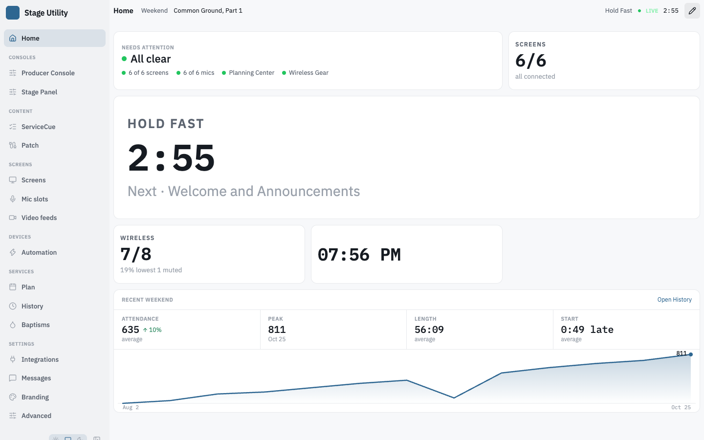
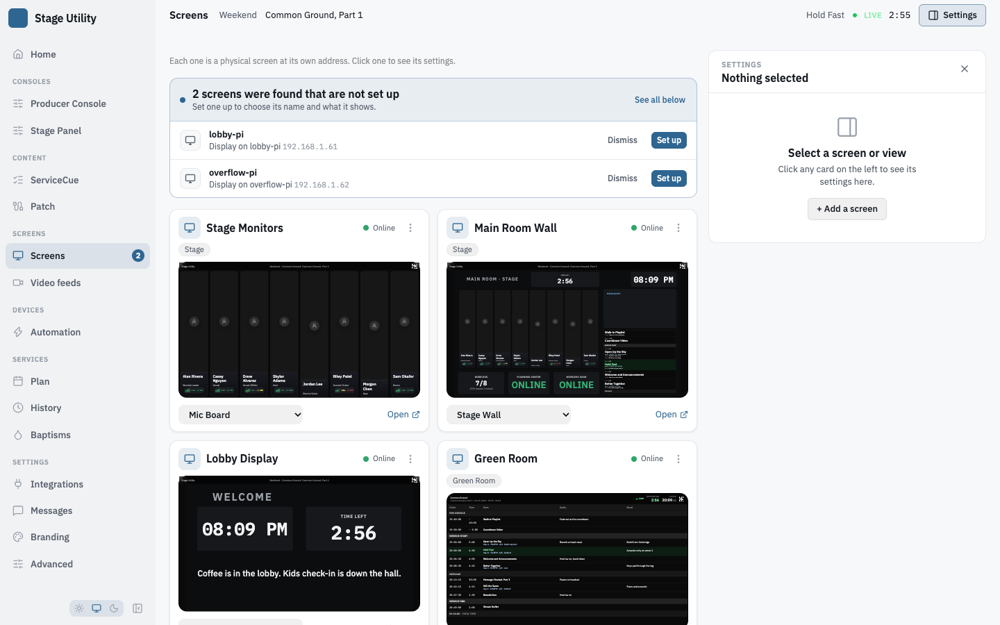
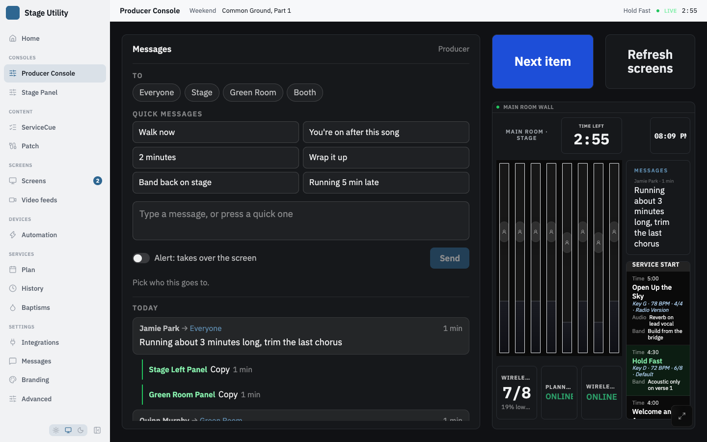

# The operator app

Everything an operator does lives at one address — the same one the screens are
on. Open the server's URL and you get Home, with a sidebar down the left and the
[live service strip](context-bar.md) across the top of every page.

There is no separate settings window and no separate tool pages. Moving between
pages does not reload the browser, so the event stream and the cached plan
survive a navigation.

## Getting started

A fresh install puts a four-step checklist at the top of Home:

| | |
|---|---|
| **Connect Planning Center** | app credentials, so plans, items and the countdown flow in |
| **Select a service & plan** | which service this machine follows |
| **Create a view** | content to show |
| **Route a display** | point a screen at it |

Each row opens the page that finishes it, and ticks itself when the work is
done. Dismiss it and it stays dismissed.

## The sidebar

| Group | Pages |
|---|---|
| — | **Home** |
| Content | **ServiceCue**, **Patch** |
| Screens | **Screens**, **Video feeds** |
| Devices | **Automation** |
| Services | **Plan**, **History**, **Baptisms** |
| Settings | **Integrations**, **Messages**, **Branding**, **Advanced** |

**Screens** carries a number when devices have been heard on the network that are
not set up, from any page, and it goes when they are set up or stop being heard.
It counts the devices the banner on [Screens](#adding-a-screen) names, dismissed ones included, and not a device set up on another server.

Consoles you have built get a row each, above the groups — see
[Consoles](#consoles). The running version sits at the foot of the sidebar. Drag
its right edge to resize it, or collapse it to icons; on a phone it becomes a
drawer. Double-click the resize handle to reset the width — on a touch screen,
tap and hold it for a **Reset sidebar width** item, since a finger has no
double-click.

**On a phone the hamburger is the only way in.** There is no swipe from the left
edge of the screen — that edge belongs to the browser's own back gesture, and a
page that takes it works on one platform, does nothing on another, and costs you
the most reliable way out of a page. The hamburger works everywhere, in a tab and
in an app added to the home screen alike.

**Drag the open drawer off to the left to close it.** It follows your finger the
whole way, and the page behind it lightens as it goes, so you can see how far you
are before you let go. A quick flick closes it however short; a slow drag lets go
past halfway to close and springs back before that. Catching one that is already
on its way out picks it up where it is rather than snapping it back. Dragging up
or down scrolls the drawer as normal, and tapping a page in it just opens that
page. With reduced motion turned on the drag still follows your finger — it is
the settle at the end that stops animating.

A page you open arrives at the top, whatever you were reading before it. Picking
the page you are already on does the same, and resets it to its top view. Back
and Forward are the exception: they return you to where you were on that page,
because that is what going back means.

Addresses for these pages, and the rules about display slugs that must not
collide with them, are in [Display URLs](../display-urls.md).

## Every page says its name

The page's name sits in the top bar on a phone, and at the left of the
[context bar](context-bar.md) on a desktop. Either way it shares a band with
something else rather than taking one of its own, so one strip of chrome sits
above the page instead of two. A console is named after the view it shows, so the
name you gave it in Screens is the name on the page and in the sidebar.

The page's own controls — Home's **Edit widgets**, for one — sit at the right of
the same band.

**The one-line description of what a page is for is a tooltip.** A single 44px
band has no second line to print it on, so hovering the page's name shows it.
Every page has one.

Pages you reach from inside another page — the layout editor, a ServiceCue
rundown, the patch editor — draw their own heading instead, so the bar shows no
name for them; on a phone the top bar names the section they belong to.

## Home

Home is a grid of widgets you build yourself, out of the same registry every
other surface draws from — anything you can put on a wall you can put here. See
[Widgets](../reference/widgets.md) for what each one shows.

**Editing.** The pencil at the right of the context bar turns on edit mode. Each tile then
gains a size picker, a visibility select, a remove button and a drag handle, and
**Add widget** offers the whole registry. The tick finishes.

**Right-click a tile** — or tap and hold it — for its size, when it shows,
remove, and the few settings that widget supports — seconds and the hour cycle
on a clock, hide-when-idle and fill-when-recording on a status widget, the
layout of the ProVideoPlayer card. No edit
mode needed, and ticking one leaves the menu open so several can be changed at
once. On a touch device each tile also carries a small **⋯ button** in its
corner, since there is no right-click to discover.

**The Sound level tile's menu** leads with two choices, **Meter** and **Metric**,
above Size and Show. **Metric** has **Automatic** first, with the metric it is
reading beside it, then every metric the chosen meter reports, each with its
live value. Pick one and the tile shows that metric, captioned
`<metric> · <meter>`. With **Loudest meter**, the list is the loudest meter's, and
once a metric is picked, "loudest" is judged on that metric. A picked metric the
meter stops reporting reads `—` and names it, never another metric's number.

### Sizes

Five shapes on a three-column grid:

| Size | Columns × rows |
|---|---|
| Small | 1 × 1 |
| Medium | 2 × 1 |
| Large | 2 × 2 |
| Extra large | 3 × 2 |
| Tall | 3 × 4 |

They tile: `Small + Medium`, `Small + Large` and three Smalls each fill a row
exactly, and a Large leaves a gap two stacked Smalls complete.

### When a tile shows

| | |
|---|---|
| **Always** | every day |
| **During a service** | only while a plan is running |
| **Rest of the week** | only while one is not |

### Placement and gaps

A widget with no cell of its own flows into the first gap that fits. Drag one
and it takes a cell — and so does everything else on the page at that moment, so
the move stays local instead of rearranging the page behind it. Nothing re-packs
afterwards, which is what lets you leave a deliberate gap between two widgets.
Dropping onto an occupied cell pushes what was there downward rather than
covering it, and so does growing a placed card, from its size chips or its
right-click menu: it keeps its cell and the cards it grows onto move down.

**Pack tight**, beside the pencil while editing, throws every placement away and
lets the page flow again. It appears only once something has actually been
placed.

Cells apply to the full-width page. Below about 520 px the grid narrows to two
columns and then one, and placements are ignored — a column chosen on a
three-wide page is not a column on a phone.

A widget you remove stays removed, across restarts and across updates. A build
that adds a widget gives it to installs that have never edited Home, and leaves
an edited Home alone.

## Screens

**Screens** has a card for every physical screen, with a live preview of what it
shows, running edge to edge across the card. The card keeps what an operator changes while working: its name, the view
it shows, the colour and icon, the message groups it is in, and the way into its
layout. Its menu (the vertical dots) is actions only:

| Item | |
|---|---|
| **Open display** | opens the screen's address in its own tab |
| **Rename view** | renames the view the screen shows, everywhere it is used. Only while a view is assigned |
| **Copy URL** | copies the screen's permanent address |
| **Refresh display** | reloads that screen |
| **Screen settings…** | opens the panel below on this screen |
| **Remove display…** | asks, then removes the screen: see [Removing a screen](#removing-a-screen). Refused for the last one |

The card's view picker lists every view, grouped as **Wall views** and
**Control surfaces**, then **+ New wall view…** and **+ New control surface…**,
which make a view of that kind and point the screen at it. A screen showing a
control surface carries a **panel** pill.

A view that no screen shows has its own card under **Views not on a screen**, with
a pill for what it is (*wall* or *control surface*) and, for a console, whether it
is in the sidebar. Its menu has **View settings…**, *Make it a wall view* or
*Make it a control surface*, *Duplicate view*, *Delete view…* and, for a console,
**Show in the sidebar**.

Under the cards: **New view** (pick what the view shows: Mic Slots, Dashboard,
Stage, Transcription, ServiceCue, SPL Rundown, Calendar or a Custom Layout, and for
a custom layout whether it is a wall view or a control surface), **Import layout…**
(see [Moving a view](../moving-a-view.md)) and **Refresh all**, which reloads every
connected display.

### The settings panel

A panel docks beside the cards, so a card and its preview stay in view while a
setting changes. **Settings**, at the top right of the page, opens and closes it. It
starts closed on every visit and nothing is remembered; it opens when asked: **Settings**,
**+ Add a screen**, a found device's **Set up**, or **Screen settings…** in a card's
menu. On a narrower window it covers the page when opened.
With nothing selected it says *Select a screen or view* and offers **+ Add a
screen**.

**While the panel is open it follows the click.** A click anywhere on a screen
card moves it to that screen's settings, and a click on a view card moves it to
that view's settings. The card's own controls keep doing their own job and do not
move it: the view picker, **Open**, the menu and the icon colour. Clicking the
name still focuses it for renaming, and moves the panel too. Clicking the preview
moves the panel; a Cmd (Ctrl on Windows and Linux), Shift or middle click on a screen's
preview opens its display in a new tab, and the small button in the preview's corner goes to
the layout editor. Dragging a card's header still reorders. With the panel
closed the cards do what they always did: the preview opens the layout editor and
a click on a card does nothing.

The panel has four faces: nothing selected, a screen's settings, a view's
settings, and a new screen.

### Screen settings

Changes save as they are made.

| Section | |
|---|---|
| **What it shows** | the view, grouped as **Wall views** and **Control surfaces**. Under the picker one line says what the choice makes the screen: a *Control surface* pill and *Its buttons work for anyone at it.*, a *Wall display* pill and *Read-only. Buttons draw but do nothing.*, or *Shows nothing yet.* **View settings →** opens the view's settings and **Edit layout** its layout editor. For a screen showing a console, **List in the sidebar** keeps that console in the sidebar's list, or out of it: see [Consoles](#consoles) |
| **Name and address** | the name; the **friendly link** (an alias such as `lobby`, saved with **Save** so a refusal stays on screen: see [Friendly URLs](../display-urls.md#friendly-urls)); and the permanent address, which never changes, with a button that copies it |
| **On the screen** | **Top bar** (the brand, plan and QR strip along the top), **Lock** (keeps the top bar but removes its links, so the screen cannot be navigated away from) and **Text size** (50 to 300 %, for ServiceCue and readouts). Top bar and Lock are offered only where the view draws a bar; a calendar or a script wall draws none |
| **Messages** | the [message groups](stage-messages.md#putting-a-screen-in-groups) the screen is in |
| **Video** | **Use HLS**. Off, the screen plays only WebRTC, and a feed that needs HLS says it can't play there |
| **Device** | the machine bound to the screen, with its hostname and address, and whether the screen is online. For a plain device the section is read-only: release it from the card. For a screen shown by an output of a [Mac output helper](../kiosk-devices.md#mac-output-helper) it also holds the port and card, **Format** (DeckLink ports), **Rotation**, the output's health (a DeckLink port also its latency) and a **Release** button |

The footer has **Remove screen…**, which asks first and is off for the last
screen.

**The view decides what a screen is.** A screen is a control surface, whose
buttons work for anyone at it, exactly when the view it shows is a console. It
is a read-only wall display when it shows any other view, or none. Choosing a view
of the other kind from the picker, on the screen's card or in this panel, asks
first (*Make "Lobby TV" a control surface?*, or *a wall display?*), because the
screen's buttons go live or stop; declining changes nothing. Pointing a screen at
a view changes only that screen. Changing what a *view* is for does change every
screen showing it: see [View settings](#view-settings) and [Consoles](#consoles).

Only a view with something to operate can be a control surface: a custom view
(its buttons, faders and fields) or a calendar (its month chevrons, which a wall
display does not draw). A slot board, dashboard, stage, transcription, script or
SPL view is never made one.

### View settings

A view's own panel. Changes save as they are made.

| Section | |
|---|---|
| **Name** | the view's name, everywhere it is used |
| **What this view is** | **Wall view** or **Control surface**. Switching it changes every screen showing the view, and a confirm names them first: see [Consoles](#consoles). Only a view with something to operate can be a control surface (a custom view or a calendar), so the other is off for any other view. For a control surface, **List in the sidebar** |
| **Shown on** | a chip for each screen showing the view, each jumping to that screen's settings; or *No screen shows it.* |
| **Layout** | **Edit layout** (a custom view) and **Duplicate**, which opens the copy |

The footer has **Delete view…**. It asks first, says the layout goes with it, and
names every screen showing the view, which will show nothing until another view
is picked. The same question is asked from a view card's menu and from the layout
editor.

### Adding a screen

A screen found on the network that is not set up is named in a banner at the top
of the page, one row per device with **Set up**, and again under **Not set up
yet** below the cards. **Set up** opens the panel below for that device. Once the
screen is made, its card is scrolled to and outlined. **Dismiss** hides a device
from the banner in this browser only, with an **Undo**; it stays under *Not set up
yet*, and **Show dismissed** brings the hidden ones back. A device that is set up
or stops being heard leaves the banner by itself, and Screens in the sidebar shows
how many devices are not set up, from any page.

**Add a screen** (the tile, or the button in the empty panel), **Set up** in the
banner, and a waiting device's **Set up as a new screen** (see
[Kiosk devices](../kiosk-devices.md)), open the same panel in two steps:

1. **Name it.** The name and an optional friendly link.
2. **What should it show?** Four choices: **a new wall view** called after the
   screen (the usual, and the default), **a new control surface** called after it,
   **a view you already have** (a picker of both kinds, with a line saying what
   the screen becomes), or **nothing yet**. The screen is whatever its view is.

   **A new wall view** opens to **Shows**, one of every kind of view: Custom
   Layout (the default), Mic Slots, Dashboard, Stage, Transcription, ServiceCue,
   SPL Rundown or Calendar, with a line under them saying what the chosen kind
   is. A Custom Layout also asks **Start from**: Blank, Dashboard or Confidence
   monitor, which fill the layout with that template. **A new control surface**
   is always a custom layout, and asks **Start from**: Blank or an Ultritouch-2,
   Ultritouch-2-HR or Ultritouch-4 strip, which also sets the canvas to that
   panel's size. The line above the buttons names what is made, for example
   *Creates the screen and a Mic Slots view, both called "Lobby".*

**Nothing is created until Create screen**, which is on the second step and, for *a
view you already have*, off until a view is picked. Left unnamed, a screen is named
**Display** and its number, and so is a view made for it (a device is named for its
hostname). Closing the panel creates nothing. A refusal (a link another screen
holds, say) leaves the panel open with the reason. A device is claimed by the same
step that creates its screen, and if that fails everything made for it is taken
back. If another operator sets the same device up while the panel is open, the panel
says which screen it became and **Create screen** is turned off. If somebody changes
the kind of a view you chose from *a view you already have* while you decide, no
screen is made: the panel stays on this step, says the view changed, and shows the
view as it is now.

After **Create screen** the panel stays open on the new screen and says what was
made; when a Custom Layout was made it adds **Edit layout**, saying whether the layout
is blank or started from a template. The other kinds draw themselves, so the note
offers no layout to start from.

### Removing a screen

**Remove display…** in a card's menu and **Remove screen…** in the panel ask the
same question in a dialog: *Its address and settings go away. This cannot be
undone.* When no other screen shows the screen's view, the dialog offers **Also
delete its view**, unticked; ticked, the button reads **Remove screen and view**.
Left unticked the view moves to *Views not on a screen*. When other screens show
the view, the dialog names them and the view stays. Removing both is two steps,
the screen first; if deleting the view fails, a message says the screen is gone
and the view is not. The view is deleted only if the server finds no screen showing
it: one that another operator pointed at it while the dialog was open is kept, and
the message names the screen that shows it now.

## Consoles

A **console** is a custom view built for someone to touch rather than to watch.
Its buttons fire; the same layout on a wall display draws them and does nothing.

**Building one.** Screens → **New view** → *Custom Layout*, then pick **A
control surface you operate** rather than *A wall view anyone can see*. A
calendar can be a console too, and pages through months on it: the dialog does not
offer that, so make the calendar view first and choose *Make it a control surface*
in its card's menu (the card of a view no screen shows). Every other built-in kind
has nothing to operate. A **Button** on one, set to Fire a cue, fires a cue and shows what its
device is doing; see [Widgets](../reference/widgets.md#control). A console meant for a
Ross Ultritouch panel has its own presets and a starter; see
[Ultritouch](../integrations/ultritouch.md).

**Changing what a view is for.** [View settings](#view-settings) has **Wall view**
and **Control surface**, a custom view's editor has a dropdown beside its type
reading *Wall view* or *Control surface*, and the card of a view no screen shows has
*Make it a wall view* or *Make it a control surface* in its menu. Either changes the
view **and every screen showing it**: those screens become control surfaces, or wall
displays, together with it. When any screen would change, a confirm names them first
(*Buttons will work on "Lobby TV" and "Hallway TV". Anyone standing at those screens
can press them.*) and declining changes nothing. A view no screen shows has nothing
to confirm. If somebody points a screen at the view, or away from it, while the
confirm is open, you are asked again with the screens as they are now, so a screen
you were not shown is never changed. The whole change is one call: if any part of it
fails, what already changed is put back and the message says which step failed. A
view that cannot be a control surface (anything but a custom view or a calendar) is
refused with the reason. To change what one screen is, point it at a view of the
other kind in [Screen settings](#screen-settings), which changes no other screen.

**Reaching one.** Every console gets its own row in the sidebar, at
`/consoles/<view id>`, and the console's own name heads the page. Renaming the
view in Screens renames both. That row is absent until a console exists, and for a console
kept out of the sidebar (below). A console can
also drive a physical screen: a screen showing a console is a control surface,
and its buttons work for anyone at it. A screen showing a wall view never has a
live button.

**Keeping one out of the sidebar.** A console can be kept out of the sidebar's
list. That suits a console that lives on a stage display as a control surface and
has no business being a place the operator works from. Turn off **List in the
sidebar** in the [View settings](#view-settings) of the console or the
[Screen settings](#screen-settings) of a screen showing it, or **Show in the
sidebar** in the menu of a console no screen shows. It is a setting
on the view, `showInSidebar`, and a console with none is listed — so every
console you had before it existed still is. Only the *list* changes. A console kept out of it
keeps its live controls on every screen showing it, still opens at
`/consoles/<view id>` with its name in the header, and the **Open** link on the
Screens card of a screen showing it still opens that screen.

**Its icon.** Right-click the glyph in that sidebar row — or tap and hold it — to
pick another one, or focus the row and press **Shift+F10** (or the ContextMenu
key) for the same set.
The console shares one icon with any Screens card pointed at it, so changing it
in either place changes both.

**Messages.** A console can carry the [Message composer and Messages
widgets](stage-messages.md#on-screens): the composer sends messages
and alerts and shows the day's thread, and Messages shows what was sent to the
groups you give it with the quick replies as buttons under the newest. A console
in the app is not a screen, so give a Messages widget on one its own groups in the
inspector. Replies and sends are signed with the console's name.

**Editing one.** A quiet **Edit** button appears near the console's top-right
corner when the pointer comes within reach. It opens the layout editor on the
same URL, and **Done** returns you to the live console. See
[Layout editor](../reference/layout-editor.md#editing-a-console-in-place).

### Running a console without the app's chrome

A console can have the app get out of its way. In Screens, open the console and
press the **bar** button beside *A control surface you operate*. Both bands go —
the top bar and the [context bar](context-bar.md) — and the console gets the
whole window.

On a 390x844 phone that is **89px back out of 844**: the console runs from the
very top of the page to the bottom instead of starting 89px down. On a desktop
it is the context bar, and with it the page's name; the sidebar stays, because
the sidebar is not a band and is the way back. The setting is honoured at every
width, deliberately — a setting that does nothing on the device you set it on is
worse than one that is occasionally unnecessary.

**A menu button floats over the console, and it never fades.** Bottom-left, above
the phone's home indicator, 44px square. It is the way back, and it is the only
one that works in every place this app gets opened: a browser's Back and its
toolbar are gone in an app added to the home screen, and Back needs history that
a console opened from a bookmark does not have. So it does not dim, and it does
not hide until you tap the screen — on a live console that first tap belongs to
whatever is underneath it.

**It sits on top of the console, and it takes the tap.** A console is buttons, so
a fixed position covers something on some layout and the app cannot know which.
It is exactly its own 44px and no more — there is no reserved strip along the
bottom, because a strip would give back half of what hiding the bars won — and it
carries its own background so it stays readable over a dark canvas. If it lands
on a control you use, move that control in the layout editor, or turn the bars
back on.

**Want some context back rather than all of it?** Do not use this — give the
phone its own [context bar](context-bar.md#a-phone-can-have-its-own-set) item
set and trim it to the two readings you actually want. That keeps the bar and
loses the clutter.

This is a different setting from a screen's **Top bar** switch, which is set per
screen in its [Screen settings](#screen-settings) and hides the *display's* bar on
a wall, in a different page entirely.

## Branding

**Settings → Branding** controls how the app introduces itself, on every screen
and in its own chrome. The page opens on the app's identity: the logo large on a
stage-black canvas with the name beneath it, as a display draws them. Beside it sit
the settings that style them. Below are the images, each drawn where it is used;
click the logo or any image to edit it in a dialog, or drop an image file on it to
replace it. The dialog opens with the image already in its crop editor: drag to
reposition, zoom with the slider, then **Save**. A new image, from **Upload** or
**Replace** or dropped on the dialog, takes its place in the editor and is not
saved until **Save**. With nothing set, the editor is a place to drop the first
image.

| | |
|---|---|
| **App name** | shown in the sidebar, on every display's top bar and in the browser tab, and used as the home-screen label when the app is added to a phone or tablet. Set it to your organization's name |
| **Accent color** | the brand color for buttons, selection, links and focus, app-wide: six presets, a custom color, or **Default**. Status colors (live / over / caution) are unaffected |
| **Recolor to match theme** | shown once a logo is set. For a single-color logo: recolors it to light, dark and the kiosk's own gray. Off shows the logo's colors exactly as uploaded |
| **Logo** | click it in the identity canvas. PNG, JPG, SVG or WebP, up to 1.5 MB, with **Upload** (**Replace** once set) and **Remove**, and the square crop edited in the dialog. Shown next to the app name and, unless a tab icon is set, used as the browser tab icon on every page. With **Recolor to match theme** on, the tab icon is the logo recolored to contrast with the browser's light or dark setting (a custom browser theme can differ from it); with it off, it is the logo as uploaded |
| **Tab and home-screen icon** | the image behind the browser tab, bookmarks, and the icon on a phone or tablet home screen. Until one is set the tab shows your logo and phones show the built-in Stage Utility icon |
| **Empty slot image** | centered in an empty mic slot on a kiosk, recolored to the display's gray. Same **Upload**, **Remove** and crop editor |
| **Default avatar** | shown for a scheduled person with no photo in Planning Center, in place of their initials, recolored to match the theme. A built-in silhouette is the fallback when unset |

The connect QR toggle is the last card on this page — see
[QR codes](../display-urls.md#qr-codes).

### Tab and home-screen icon

Click the icon card, then **Upload** a square PNG, JPG, SVG or WebP (512 x 512 or larger looks sharpest),
or press **Use my logo** to build it from the logo already set. Smaller art is never refused: the editor, and the dialog for **Use my logo**, say when it is smaller than 512 x 512 and may look soft. Stage Utility draws
every size from that one square in your browser: 180 px for the iPhone and iPad
home screen, 192 and 512 px for Android and the tab, and a second 512 px version
for Android's round and rounded-square masks with the art kept inside the centre
80%. The dialog previews it at tab, iPhone and Android sizes.

**Background** fills the transparent areas of your art (black, two blues or white);
phones would otherwise fill them with black. Changing it redraws every size at once.
Once set, the dialog opens with the icon's square in the crop editor, and offers
**Replace** and **Remove**. Removing it puts
everything back: the tab follows the logo again, and phones get the built-in icon.

A tab icon is shown exactly as drawn and never recolored, and it wins over the logo.
The tab loads it from `/icon-192.png`, which answers with the built-in icon if the
stored file is ever missing, so the tab is never blank. The home-screen label is the
app name, read by iOS when the app is added, so renaming the app does not rename an
icon already on a home screen; adding it again does. The manifest and icon files
behind this are listed in the [API](../reference/api.md).

## Advanced

**Settings → Advanced** holds the settings you touch rarely. It is split into tabs, and
each tab has its own address, `/settings/advanced/<tab>`, so a tab can be bookmarked or
sent to someone. `/settings/advanced` opens General; an address that is not a tab shows
General too. The sidebar keeps **Advanced** lit on every tab. **Server log** at the
right of the heading opens the raw log, `/log`, in a new tab.

| Tab (`<tab>`) | Cards | Holds |
|---|---|---|
| **General** (`general`) | General | **Time zone**, **Clock format**, **Context bar** |
| **Updates** (`updates`) | Updates | the update status with **Check now**, **Update now** and **Restart**, **Update track**, how updates are applied and the **Update window**, and whether Mac output helpers and Windows kiosks follow the server |
| **Schedule** (`schedule`) | Reconnects, Attendance sampling | **Wake around service times** and its three timings; the **Pre-service ramp** and **Post-service taper** |
| **Network** (`network`) | Addresses, Host names | the **Public address (DNS)**, whether the server **answers devices looking for a server**, the commands that set up a screen; the host-name list and its refusal switch |
| **Data** (`data`) | Backups, Records | **Automatic backups** and the **Config snapshot**; the **Data archive** and **History milestones** |
| **Video relay** (`video`) | Video relay | the relay's ports and the ffmpeg path |
| **Search** (`search`) | | every setting, below |

A tab with two cards draws them side by side on a wide screen and one above the other on
a narrow one.

### Search

**Search** is the last tab. Press **Cmd-F** (**Ctrl-F** on Windows and Linux) anywhere
on the page to open it with the cursor in the box and any earlier text selected. The
page takes the key only while it is open. The query stays when you move between tabs.

Every word you type must match the setting, in any order, in its name, the card it sits
in, its description or words people use for it that the page does not print (`dns` finds
the public address, `branch` the update track). A word matches the start of a word, so
`recon` finds the reconnect settings. A word of four letters or more also forgives a typo
in a setting's **name** or its card's: one slip up to seven letters, two from eight. A name match ranks above a hidden
word, which ranks above the description, which ranks above a typo.

Results are the settings themselves, working, in cards headed with the tab and the card
(**Data › Backups**). Click the tab name to go there. A line above them counts the matches.
Searching `log` also offers the **Server log**. A setting the page is not drawing, such as the reconnect timings while **Wake around
service times** is off, is not searched.

## Read-only links to hand out

Two pages are meant to be sent to people outside Production, and are read-only
for that reason:

| | |
|---|---|
| `/history` | service history, timing and attendance, without the controls that change it |
| `/patch` | this week's stage patch, following the live or next plan on its own |

`/history` also renders with none of the app's chrome — no sidebar, no context
bar — since the person it is sent to has nothing else on the page to reach.
`/patch` keeps the ordinary shell; it is read-only in what it lets you do, not in
what surrounds it.

The operator's own versions are in the sidebar: **History** (which is
`/history/manage`, and keeps Edit times, Merge, Rebuild from raw and Delete in
a service's header) and **Patch**, whose editor is at `/patch/edit`.
