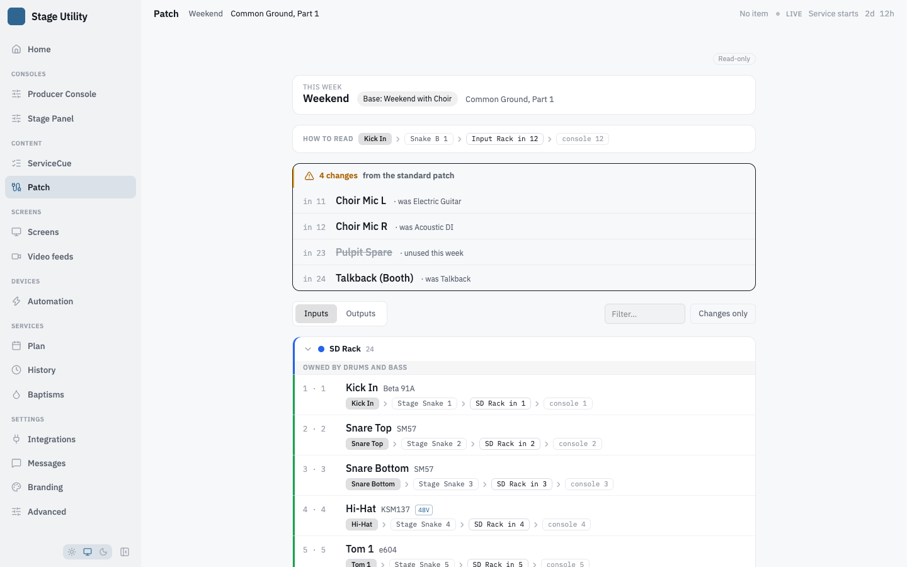

# Patch sheet

A per-week stage patch reference: what source lands on which console input, where
each output feeds, and — the part volunteers actually need — what changed from the
standard this week.

Edit it with **Edit the patch** on the **Patch** page (`/patch/edit`). Volunteers read it at **`/patch`**, which
follows the live or next Planning Center plan on its own.

## The editor

`/patch/edit` is laid out like a spreadsheet.

- **Top row** — a tab per sheet, an underline marking the active one, and **+** to
  add a sheet. The active tab carries a **⋯** menu with **Rename** (edits the tab in
  place; Enter keeps the name, Escape abandons it) and **Delete sheet…** (asks first,
  and is unavailable on the last sheet). At the right: **Import**, **Export** and
  **Print**.
- **Second row** — **Inputs / Outputs**; **Editing**, which picks the Default patch,
  This week or a variant, with **New variant**; **By rack / By device**; and the
  **Ripple** switch.
- **Left column** — the **Devices** card and the **Weekly assignment** card, always
  open.
- **The sheet** — one card per rack, one 32px row per channel. A cell reads as plain
  text until you hover or focus it, and every cell is a real field, so Tab walks the
  row. The path is a line of chips, each a color dot and `Device · connector`; click
  a chip to change its device or connector in place, **+ hop** (shown on row hover)
  adds one, and an empty row reads *direct · add hop*. The row's left edge takes the
  color of the first hop's device.

An unsaved-changes banner with **Save** and **Discard** floats at the top while the
draft differs from the saved patch.

## Sheets

The patch is a set of sheets, each an independent surface of the same shape — the
way a console patch spreadsheet is usually organised: analog stage patch, Dante,
Waves SoundGrid, monitoring.

Each sheet has its own devices, endpoints, variants and weekly assignments. Sheets
can be colour-coded and marked with which team owns them.

## Devices

Each sheet's device list, in the left column, is the rack spine every endpoint references: racks,
snakes, drop snakes, floor pockets, wireless/RF and arrays. A device has a
**name**, a **color** that tints every channel sourced from it in the table and
on `/patch`, and can generate sequential connector labels from a **prefix**
(`B-`) and a starting number — those labels autocomplete in the From/To path
cells and ripple cleanly (`B-1` → `B-2`) in the patch table.

Each device is one line — color, name, kind, and input/output counts. Click it to
open its editor under the line: name, kind, channel counts, color (ten swatches or
none), and the connector-label generator. **Add device** appends a rack and opens it.

## Inputs and outputs

Both are first-class, on their own tabs.

**Inputs** — one row per rack input: console channel, source, mic or DI, 48V, and a
**From** path of ordered hops back to the stage box.

**Outputs** — one row per rack or console output: destination, feed type (IEM,
wedge, amp, stream, record), console channel, and a **To** path out.

Both are inline-editable and can be grouped **by device** or **by rack**. The
connection diagram is drawn from the path — there is nothing to wire by hand.

## Variants and the weekly patch

A **variant** is a named set of overrides on the default patch — a reusable
template or a specific event. Only the differences are stored, so re-wiring
infrastructure on the default flows through to every variant automatically.

What a given week resolves to, lowest priority first:

```
default  →  service-type standing variant  →  per-plan variant  →  week tweaks
```

Anything differing from the default is marked as changed, which is what drives the
volunteer highlight.

## The volunteer view

`/patch` leads with **what changed** — each with a note: *was `<old label>`*, *new*,
*re-patched* or *unused this week*. Below that is a legend showing the resolved chain as connected nodes
(`Source → Snake B/1 → SD 1.11 in 12 → Console 12`), then the full patch grouped by
device with collapsible headers, a filter, and a **Changes only** toggle.



It updates live, without a reload.

## Bulk entry

Wiring a snake across a rack channel by channel is slow, so the editor has two aids.

**Ripple fill** (DiGiCo-style) — in **By rack** mode, turn on **Ripple**; a bar with
the options appears across the top of each rack card. Choose how far the fill reaches (2 to 12 channels, or to the end of the rack) and which columns
ripple. From and Console are on by default; Source, Mic and 48V are available for
inputs, To, Console, Dest and Feed for outputs, and Owner on sheets that have an
Owner column. The bar names the row the next fill starts from and the rows it will
reach are tinted. Ripple is one-shot: it switches itself off when you leave the cell
you filled from.

**Connector labels** default to numeric and can be edited to whatever the rig uses
— `B-1`, `S11`, and so on.

**Import** accepts CSV and Excel with column mapping, for bringing in an existing
spreadsheet.

## Export and print

Three ways out, beside Import. **Export** opens a menu of the two file formats:

| | For |
|---|---|
| **Export CSV** | anything that reads a spreadsheet, and re-importing here |
| **Export Excel** | sending to someone — column widths set, header frozen |
| **Print** | the copy that gets taped to the rack |

The file always covers the **one sheet you are looking at**. If you are editing a
variant, that variant's patch is exported and its name is in the filename, so
`analog-stage-baptism-week-2026-08-03.csv` is not mistakable for the default a year
later.

Columns are `Rack ch`, `Console`, `Dir`, `Source / Name`, `Mic / Feed`, `48V`,
`Rack`, `Path`, `Owner`, `Notes`. **Path** carries the whole signal chain as
`Snake A:2 -> SD Rack:2`, which is the column an engineer actually traces; a direct
patch leaves it blank. A hop whose device has since been deleted shows the raw
device id rather than disappearing — losing a hop would misstate the path, and the
path is the point of the document.

Channels are written as text, so a leading zero survives: `01` stays `01`.
Endpoints marked unused are left out.

The headings are chosen so this app's own importer recognises every column without
hand-mapping, which makes the export a working backup as well as a document.

Export reads the **saved** sheet, so the button is disabled while you have unsaved
changes rather than quietly handing back an older patch.

Print leaves only the sheet on the page — no sidebar, toolbar or side cards — in
black on white. The column header repeats for each rack, and rack groups are kept off
page boundaries. A hop keeps its device's color on its dot, 48V prints as an empty or
a filled switch, and empty cells print empty rather than showing their hint text.
There is no separate PDF export — print to PDF.

## Where it is stored

`patch.json` in the data directory, included in config backups.
