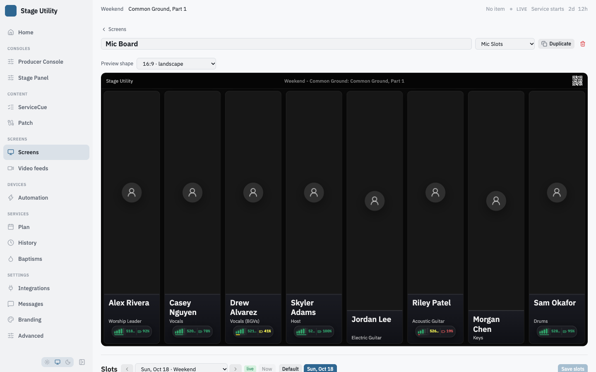

# Mic slots

A slot is one cell on the mic board. It links to a person, optionally binds a
wireless mic and an IEM pack, and shows a name, photo and live telemetry.

Slots live on named **boards**. A Mic Slots view, or a mic-slots object in a custom
layout, shows one board, and several can show the same one: edit it once and every
screen showing it changes. Boards are created, renamed, duplicated and deleted on
the **Mic slots** page, with no limit on how many. A copy of a view shows the same
boards as the original, unless the copy is made with its own. See
[Slots](reference/data-model.md#slots) and the [board routes](reference/api.md#slot-boards).

## The Mic slots page

**Mic slots**, in the Screens group of the sidebar, edits every board at once.
A Mic Slots screen's **Edit** on the Screens page opens it on that screen's board
(`/mic-slots?board=<id>`), scrolled to and selected.

**Nothing reaches a screen until Save all.** **Unsaved changes** shows beside it
while any board has work in it. Leaving the page, or moving the plan switcher, with
unsaved work asks first.

### The top bar

| Control | What it does |
|---|---|
| **Plan switcher** | `‹ name ▾ ›` and **Now**: which plan's layouts every board on the page shows and saves to. See [Switching plans](#switching-plans-in-the-editor) |
| **Default** and **<plan> only** | Which side of the plan is being edited, for every board at once. **EDITED** marks a plan that has a layout of its own on some board. See [Defaults and this week](#defaults-and-this-week) |
| **⋯** (plan actions) | **Revert** this plan to the default, **Set** this plan **as the default**, and **Copy every board from another plan or service type…**. Each acts on every board with a layout for the plan, and says which boards it could not do |
| **Saved layouts** | [Saved layouts](#saved-layouts) |
| **Save all** | Writes every board with changes in one request |

Save all is all or nothing. The server checks every board before it writes any, and
a refusal names the board that failed (`Board "Left wall": …`): the page keeps every
edit and marks that board.

### A board

Each board is a section with its name, **Shown on** (each screen or widget that
shows it), its slot count, **+ Slot**, **+ Spacer** and a **⋯** menu. Under that is a
screen-shaped preview drawn by the same components a screen uses, filled with the
people the plan being edited puts on each slot, and a line saying so ("Previewing
Sun, Sep 20 · 6 of 8 positions filled"; "positions only, no plan" on a default). The
line is absent on the live plan.

The **⋯** menu:

| Item | What it does |
|---|---|
| **Rename**, **Duplicate board** | Duplicating copies every service type's layouts and plan layouts, with new slot ids |
| **Shown on** | A checklist of every Mic Slots screen and every mic-slots widget. Checking one points it at this board. To move a screen off a board, check it on another |
| **Copy this board from…** | Copies a layout over this board's layout for the plan being edited: from **another board**, from a **service type** (its default) or from a **plan** (its own layout, else its type's default). Written at once, after asking if the board has unsaved edits |
| **Revert this board to the default** | Deletes this board's layout for the plan being edited. Offered on the plan side when it has one |
| **Charger layout…** | [Aligning to chargers](#aligning-to-chargers) |
| **Delete board…** | Names what goes with it (the service types it has a layout for, and the upcoming plans with a layout of their own) and every screen showing it, and asks what those screens show instead: another board, or nothing. **Save it as a saved layout first** to keep a copy |

A board with no layout for the service type being edited shows **No layout for
this board yet**, and offers **Copy the <type> layout** (from another type that has
one), **Recall a saved layout** and **Start blank**. The screens showing it draw an
empty board for that type's plans until it has one.

**+ New board**, under the boards, asks for a name and a starting point: **Blank**, a
**Copy of** a board, or **A saved layout** (placed under the service type and plan
being edited), and optionally which screens and widgets show it.

### Drag, drop and stack

Every card and every gap on the page is a drop target, including on another board.

| Drag | Drop | Result |
|---|---|---|
| A card | in a **gap** between columns | The card becomes a column of its own there. A card dragged out of a stack leaves it |
| A card | on the **lower half of another card** | It stacks directly below that card, in that card's column |
| The **bar over a column** | in a gap | The whole stack moves |
| The bar over a column | on a card | The two stacks join, the dragged one below that card |
| A **spacer** | in a gap | It moves like a column. A spacer never stacks, and nothing stacks onto one |

A drop that changes nothing is not an unsaved change.

From the keyboard, with a card focused (click it, or Tab to it):

| Key | What it does |
|---|---|
| **←** **→** | Moves the card's column one place. A card inside a stack leaves it, to that side |
| **↑** **↓** | Reorders a card inside its stack |
| **Shift+↓** | Stacks the card onto the column to its left, skipping spacers |
| **Shift+↑** | Takes the card out of its stack, into a column just after it |
| **Delete** | Removes the card |
| **Space** | Picks the card up; the arrow keys then carry it between zones, including onto another board, and **Space** drops it |

The inspector's **Stacked** switch does the same as Shift+↑ and Shift+↓.

### The inspector

Select a card, or a spacer, to edit it. A spacer has only a **Width**.

**Who**

| Control | What it does |
|---|---|
| **Position / Person / Label / Empty** | How the slot is filled: by position and person from Planning Center ([below](#linking-a-slot-to-a-person)), a typed **Label** with a color, or nothing. A label slot takes no part in Planning Center matching and can still carry a mic, IEM and charge bar. An empty slot is a blank cell with no further options |
| **This plan** | Who the plan being edited puts on the slot, or a note that a default resolves no one |

**Hardware**

| Control | What it does |
|---|---|
| **Mic** | The wireless channel this slot's mic is bound to, from the [Wireless](integrations/wireless.md) integration, with its live battery: the cell shows its RF bars and battery. **Offline (manual label)** is for a mic or pack with no network: the cell shows its label in the same row, without bars. **None** clears it |
| **Shows as** | Text shown in place of the frequency, with **Use receiver name** to fill it from the receiver. See [Labels](#labels) |
| **In-ear pack** | A second device, on any slot, whose battery shows on its own row under the mic's. Same choices as Mic, with an **In-ear label** under the mic label |
| **Battery from** | **Mic** (the transmitter), a **Charger bay** (pick the bay from the chargers the Wireless integration reports, with its level), or **Off** |
| **RF bars** | Off hides the RF bars and shows only the battery level, for charge-only or IEM slots |

**Placement**

| Control | What it does |
|---|---|
| **Channel number** | A short number for the slot, such as `01`, drawn as a badge on the cell's photo. Blank draws no badge |
| **Stacked** | Puts the slot in the same on-screen column as the one to its left, as rows, for a dual-bay charger two people share |
| **Column width** | When the board is aligned to chargers: this column's width in inches, **Auto** being the board's charger width |

The header's **Duplicate** copies who fills the slot, with the next channel number
and none of its hardware (two cards on one receiver is never what a duplicate is
for); **Remove** deletes it.

### This plan's check

Under the boards, **This plan's check** reads the saved layouts against the plan
being edited:

- **On the plan, on no slot**: people whose position some board names but who landed
  on no slot, with **Add to <board>** for each board naming it. The button adds a
  slot for that position to the board's unsaved edits.
- **Slots that accept no position**: a position slot with nothing in it, with
  **Show it**.

It is read from what is saved, so Save all first to check your edits. A default has no
week, so it has no people to check. If Planning Center cannot be read the check says
so and skips the people.

### Aligning to chargers

A board's **Charger layout…** has **Align to chargers**, off by default, and the
**charger column width** (3.49 in to start). On, a column's width is set in inches
against the screen's active width, so the cells line up with the chargers below
them. A **spacer** is a blank gap for the space between charger banks and the side
margins, and a stacked column counts once. The preview draws a bracket under each
run of columns between spacers, and the line under it says how many inches are used
of the display's, in red when the row is wider. Without alignment every column, a
spacer's included, takes an equal share of the width.

The column width belongs to the board, so every screen showing it shares it. The
**display width** (32.25 in for a 37 inch 16:9 panel) is each screen's own: set it in
the screen's settings on the Screens page (a Mic Slots screen) or in the widget's
**Display width** in the layout editor. A screen with no display width is not aligned.

## Linking a slot to a person

A slot can be linked **by position**, **by person**, or given a **static** label.

### By position

A slot lists every position it will accept, and fills with the first one that has
someone available. Each entry can carry its own note filter, matched against the
team member's note in Planning Center.

| Positions listed | Fills with |
|---|---|
| `Vocals` (note starts "4") | the vocalist noted 4 |
| `Vocals` | whoever is on vocals |
| `Acoustic`, `Electric` | the acoustic player, else the electric player |
| note starts "IEM 3", no position | anyone noted "IEM 3", whatever their position |

Listing several positions is how one cell covers "the vocalist noted 4, or failing
that whoever is on acoustic". The note sits on each position rather than on the
slot, so the two can differ.

A position with a note never falls back to an arbitrary person in that position —
an unmatched slot stays empty rather than showing the wrong face.

Sub-variants group with their base: `Vocals (BGVs)` fills a slot asking for
`Vocals`.

**The picker.** Open the list to tick positions.

- **Positions come from the service type being edited**, the one the plan
  switcher points at, not whichever type is live. Editing another type's board
  lists that type's teams and positions.
- **Selected** is pinned at the top, in the order you ticked, with a count. Untick
  from there to remove one. Removing a position removes its note filter with it.
  A position the edited type does not have stays in Selected so it can still be
  removed, tagged with the type that has it (`Kickoff only`) when that is known,
  or `not in this service type` otherwise.
- **Any position** follows Selected, then the edited type's teams, minus what is
  already selected. Search filters every group, Selected included.
- **Show positions from other service types**, under the search box and off by
  default, adds every other type's positions not already listed, grouped by type
  and tagged with it. It reads each type from Planning Center the first time it
  is turned on.

A position matches by name, not by type. A name ticked from another service type
fills the slot on any type that has a position with that name.

### By person

A slot linked by person always shows one individual, whether or not they are
scheduled on the plan, and whatever position they hold. Enter their Planning
Center person ID, copied from their page in Planning Center: the URL ends
`/people/AC12345678`. The `AC` form, the bare number and the whole link all work.

When the person is on the plan, the name and photo come from the plan's roster.
When they are not, the server reads them from Planning Center by ID once and
keeps them. It asks Services first, then People for someone who has never been
added to a Services team, so anyone in the church's People database works. The
People read uses the same App ID and secret and needs read access to People.

| The ID | Slot shows |
|---|---|
| on the plan | the person, from the roster |
| not on the plan | the person, read by ID |
| no such person in Services or People | nothing; logged once as `[pco] no Planning Center person` |
| Planning Center unreachable, or the credentials cannot read People | nothing until a retry succeeds, ten minutes apart; each failure logged, naming People when that read failed |

A by-person slot takes no part in position matching or notes: the same person can
also fill a position slot on the same board.

### Slots that share people

**Slots listing an identical set of positions compete for the same people; slots
listing different sets do not.** Competing slots claim in board order, and each
person fills at most one of them.

Three slots all listing `Acoustic, Electric` with two guitarists scheduled: two
fill, the third stays empty. An empty range slot is a normal outcome.

A slot listing `Vocals→4, Acoustic` and another listing just `Acoustic` are
different sets, so both show the guitarist — which is what you want when someone
has two devices and needs to see both.

The inspector flags any slot sharing its set with another, since adding one position
changes the grouping.

## Defaults and this week

Every board has a **default** layout per service type: the lineup that type comes
back to every week. A change made while a Planning Center plan is selected is saved
against **that plan only**, and the next plan of that type shows the default again.

The top bar picks which of the two you are editing, for every board:

| Side | What it is |
|---|---|
| **<Type> default** | the service type's standing layouts |
| **<plan date> only** | that plan's layouts. **EDITED** appears once any board has one |

A plan whose board has no layout of its own opens as an editable copy of the
default. Revert and Set as default, in the plan actions and on each board's menu,
appear once a plan has a layout of its own:

- **Revert** deletes that plan's layout, so the screens go back to the service
  type's default.
- **Set as default** makes that plan's layout the service type's default, and the
  plan stops being an exception.

Both discard something, so both ask first. Saving the default while a plan's own
layout is in effect changes nothing on any screen: the plan's layout still wins
until it is reverted or the plan advances.

Everything that writes slots lands on the side you are editing: Save all, copying a
layout over a board, and a saved layout made into a board. A copy reads the
source's layout for that same side and never deletes the layout on the other side.
Copying onto the plan side from a source that has none for the plan copies the
source's default into your plan's layout, so your screen matches it without your
default changing.

A plan's layout is deleted automatically once the plan is more than 30 days past.
Defaults are never pruned. When Planning Center cannot be reached to date a plan,
nothing of that service type is pruned.

Exporting a view carries the boards it shows, with the defaults for every service
type. Per-plan layouts do not travel, because a plan id means nothing on the far end.

To move one service type's whole setup, every board it has, use the plan export
instead: **Plan → Export plan…**. See
[Moving a view between installs](moving-a-view.md#moving-a-plan).

### Switching plans in the editor

The page carries a plan switcher, `‹ name ▾ ›` and a **Now** button, in its top bar,
and the layout editor carries one in its toolbar. It changes **which plan's layouts
you are editing** and nothing else: what the screens follow is still set on the Plan
page.

A badge says which you are looking at. **live** means the editor is on the plan the
screens are following; **editing** means it is on some other week or some other
service type, and a save there changes nothing on any screen until that plan comes
round. The save toast is the ordinary one while live and a quieter one while not.

**Now** returns to the plan the screens are following, and the editor follows it
forward from then on, including when auto mode advances it mid-session.

The previews follow the switcher: step to next Sunday and every board draws next
Sunday's people. On a **default** it reads "positions only, no plan": a default is
every week, so it has no roster and the rows show the positions they are linked to
rather than guessing at a week's names. If Planning Center cannot be read the line
says so and the rows again show positions only, with the reason on hover.

Two modes, set on the Plan page:

| Mode | The middle | The arrows |
|---|---|---|
| **Within a type** | a dropdown of the active service types | that type's plans, Default first and then each upcoming date |
| **Upcoming plans** | the date and the type, e.g. "Wed Sep 10 · Youth Night" | every active type's plans in date order |

In **Upcoming plans** the middle's dropdown lists the next ten plans and a
**Defaults…** group with each active type's default. The arrows do not wrap: at
either end of the list the arrow is simply disabled.

A target that is not on the list, a type's default while in **Upcoming plans** or a
plan old enough to have dropped out of the window, sits immediately before its own
service type's first listed plan, so **›** from it lands on that type's earliest
listed plan rather than on the top of the week.

The list covers the last seven days and the next sixty, refreshed from Planning
Center at most every five minutes. When Planning Center cannot be reached the
switcher shows the plan the screens are following, disables the arrows and says
"Planning Center unreachable"; the boards on screen are still editable.

Switching with unsaved edits asks first, the same question leaving the page asks. A
new tab, or a reload, always opens on the plan the screens are following: where the
switcher was pointed is never remembered.

### Saved layouts

**Saved layouts**, in the top bar, keeps named copies of **one board** each. Pick a
board, name it, **Save**: it captures the board as the editor shows it now, unsaved
edits included. Each row shows its name, the board it came from, its slot count and
the date, with **Recall into** that board (or another, from the arrow beside it) and
a **⋯** menu: **Overwrite** with the board named in the Save picker, **Rename**,
**Export file** (a `.slots.json`) and **Delete**. Rows are dragged into order.
**Import a file** reads such a file, and **Export the current board** writes one.

**Recall fills the editor only.** It replaces that board's slots in the editor,
asks first if the board has unsaved edits, and nothing reaches a screen until Save
all. Saved layouts are global and can be recalled into any board and service type.
Position names are per-service-type, so a slot listing several positions travels
better than one naming a single position that another type does not define. A
layout saved before boards existed, or imported from a file, has no source board and
recalls into the board the page is working in.

## What the card shows

A filled slot is a photo with a name band under it. Everything on it scales with the
slot, from the editor's preview to a 4K column, and the phone view draws the same
things over the bottom of the photo.

- **On the photo.** Top left, the slot's **Channel number**. Top right, a small ears
  badge when the person brings their own in-ears. Bottom left, the capsule plate:
  their microphone capsule. The last two come from [prep tags](integrations/planning-center.md#prep-tags)
  in Planning Center and appear only for a slot filled by a tagged person. The badges
  are neutral white on dark glass; the app's accent colour is never used on stage.
- **The band.** The name, the position line, a hairline, then flat rows: the **mic
  row** (RF bars, the label or frequency, and the battery percentage) and, when an
  IEM is bound, the **IEM row** (headphones, its label, its percentage). Percentages
  are green from 60, amber from 25 and red under 25. **RF bars** off drops the bars
  and the frequency and keeps the percentage. A device with no network shows its
  label in the same rows, with no bars and no percentage. A charger bay's level, or
  an IEM pack's, shows as a battery row even with no live mic bound, without bars.
- **Low battery.** When the mic's battery is under 25% the card's edge goes red.
- An empty slot is a quiet blank cell; a spacer draws nothing.

## Labels

`deviceLabel` and `iemLabel` are per-slot text. On a live device the mic label
replaces the frequency in the mic row and the IEM label is the text of the IEM row;
RF bars and battery are unaffected. On an offline, manually assigned device the
labels are the whole row.

The label's presence is the switch — blank shows the frequency, filled takes over.

The inspector offers a **Use receiver name** button to fill the label from the
receiver's own channel name in one click.
